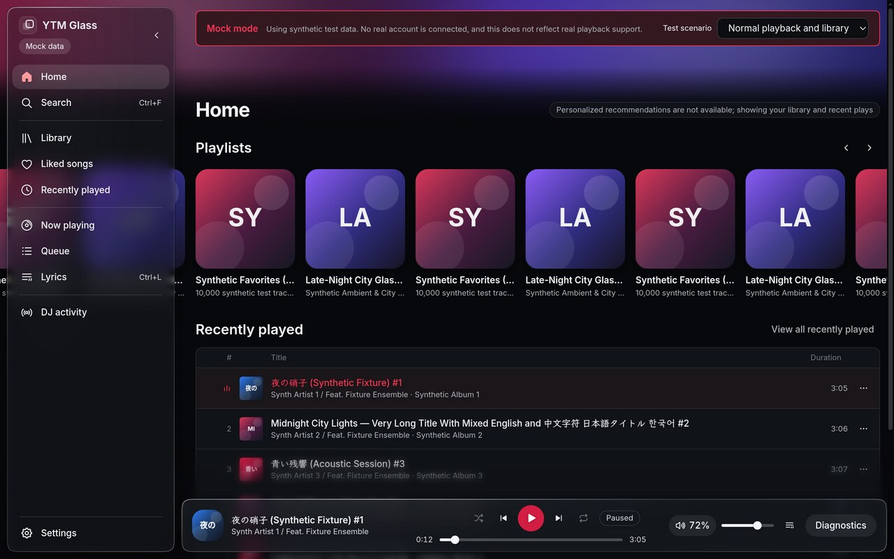
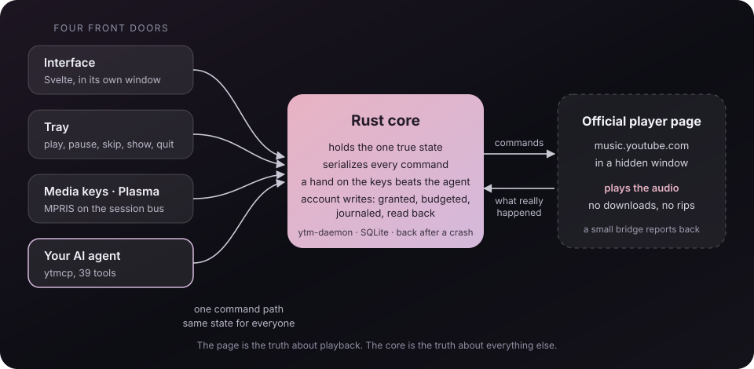
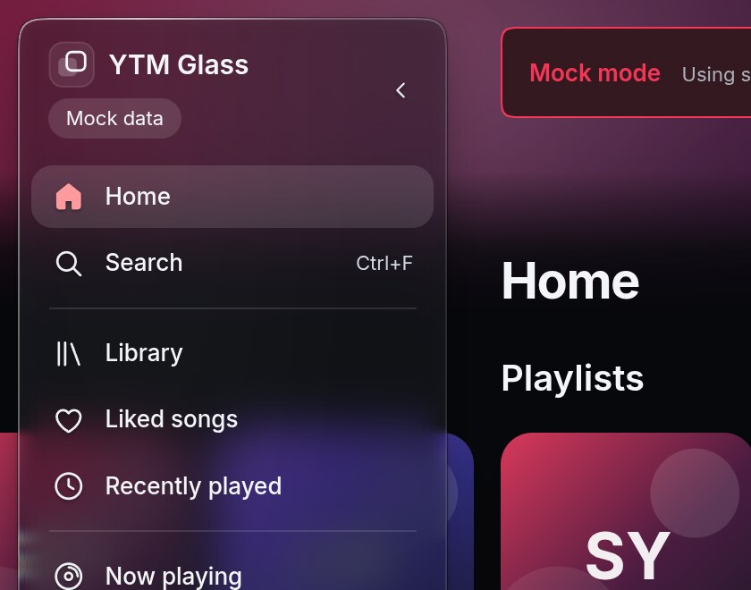
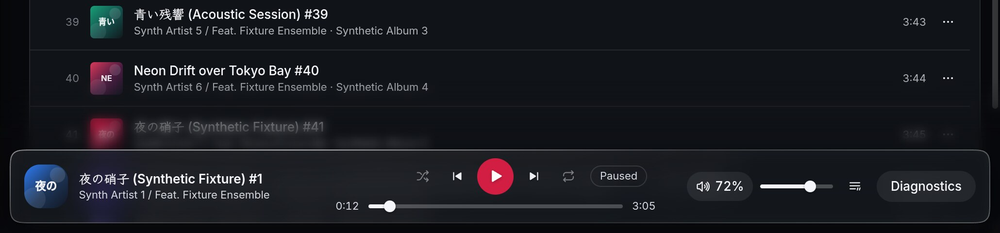
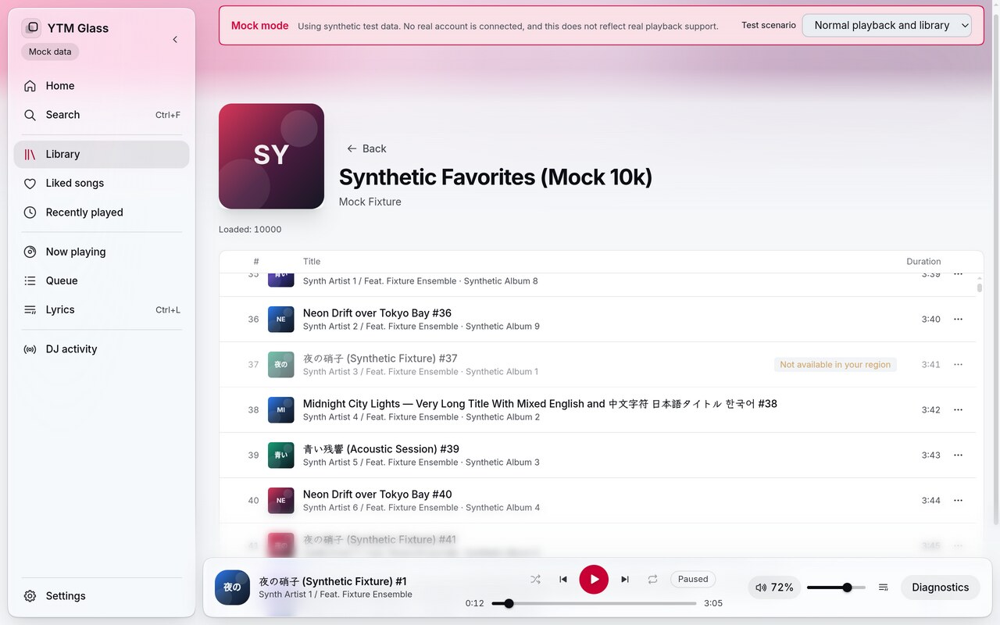
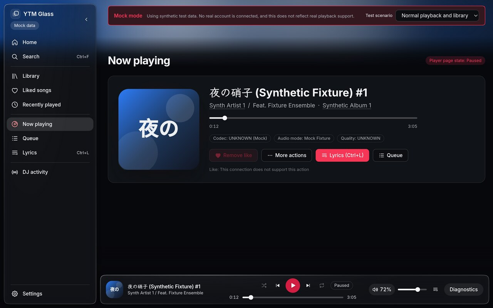
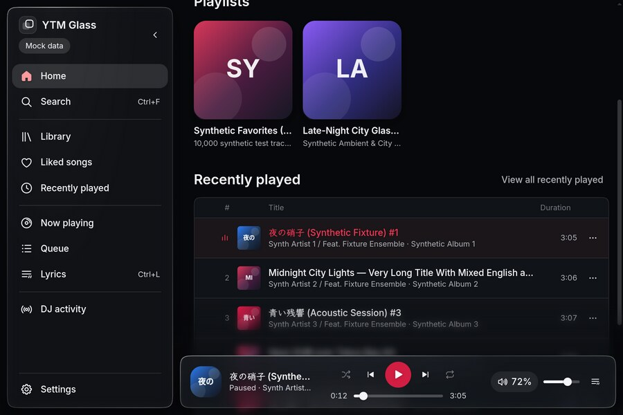

# YTM Glass

**YouTube Music, in a glass window of its own on Linux, with an AI agent working the decks.** You keep playing your game. The agent searches, queues, cuts in and remembers what you like. Touch a key and you're in charge again.



*Home, dark theme. Every screenshot on this page uses the built-in synthetic test library (`just dev-mock`), which is why the app says "Mock mode" at the top and the covers are made of initials. Your library will have real covers and fewer songs called "Synthetic Fixture #1".*

## Unofficial. Very much on purpose.

YTM Glass is not affiliated with, endorsed by or sponsored by Google or YouTube. "YouTube" and "YouTube Music" are trademarks of Google LLC.

- **The official player plays.** `music.youtube.com` runs in a hidden window and makes every sound you hear. YTM Glass never downloads, extracts, rewrites or stores a media stream, and there is no offline audio. Nothing to rip, nothing ripped.
- **You sign in, yourself.** On Google's own sign-in page, inside the app. YTM Glass never asks for, records or automates your credentials, and it doesn't borrow cookies from your other browsers.
- Use it in line with the YouTube Terms of Service and your YouTube Music subscription.

## One player. Four front doors.



The window, the tray, your keyboard's media keys and your agent all go through the same Rust core, so they always agree on what's playing. The page is the truth about playback. The core is the truth about everything else. And when you and the agent reach for the same song at the same time, you win. Every time.

## The short version

- **Liquid glass, not a web page in a frame.** The sidebar, the player bar and the popovers refract what's behind them. It looks expensive. It isn't: with the window hidden, the animations stop asking for frames, and the 10 000-track playlist scrolls a virtualized list, not 10 000 rows.
- **An AI DJ that knows when to shut up.** It gets a cue 45 seconds before each song ends (75 when the queue is running dry), and an occasional "how's it going?" check-in that gets rarer every time you ignore it. Set it to `off`, `quiet`, `normal` or `chatty`. Pause the music and it stops nagging.
- **Your hand beats the agent.** Pause, skip or reorder by hand and the agent's pending move loses. No popups asking whether you're sure. You were sure. You pressed the key.
- **Account writes are earned.** Playing and queueing are free. Likes and new private playlists need the `record` grant and stop at 100 items a day. Editing a playlist you already have needs a time-limited `edit` grant for that exact playlist and stops at 20 items a day. Every write is journaled and read back from YouTube Music before anyone calls it done.
- **It survives itself.** If the background daemon crashes, the app starts a new one, and the window and the tray pick up the new state without a restart. A write that was in flight is reported as unclear, never quietly sent again.
- **KDE-native where it counts.** Media keys and the Plasma media applet through MPRIS (`org.mpris.MediaPlayer2.ytm_glass`), a tray icon, track-change notifications if you want them (off by default, because games).
- **Playback picks up where it left off.** Queue position and settings survive a restart. It resumes paused unless you tell it to start playing on launch.
- **English by default, Simplified Chinese in Settings.** Plus synchronized lyrics from the official source or LRCLIB, with a per-song offset when the timing drifts.

## Built from glass. Measured anyway.



*The sidebar at 2x. The colour behind it belongs to the page. The glass just bends it.*



*The player bar at 2x. Tracks scroll underneath it and stay readable through it.*

Contrast on glass isn't eyeballed: a probe drives the real interface, takes screenshots and measures every label against what's actually behind it, in both themes, at five scroll positions of a 10 000-track list. Reduced transparency, reduced motion and forced colours each have their own fallback. Details in [docs/design/liquid-glass.md](docs/design/liquid-glass.md).


*Lyrics follow the song. Click a line to jump there. If they run early or late, nudge them half a second at a time; the offset is remembered for that song.*



*Light theme, a 10 000-track playlist, and a song the region won't play, marked before you ever click it.*



*Now playing. If the connection can't do something right now, the button says so instead of pretending.*



*At 900 × 600. Small enough to sit next to a game; everything still fits.*

## Install

You build it. It's an Arch package and the recipe is in the repo.

You need Rust (pinned in [rust-toolchain.toml](rust-toolchain.toml)), Node.js and pnpm (pinned in [package.json](package.json)), [`just`](https://github.com/casey/just), and `base-devel`. The full story is in [docs/building.md](docs/building.md).

```sh
pnpm install --frozen-lockfile
just package                                   # writes packaging/out/ytm-glass-<version>-x86_64.pkg.tar.zst
sudo pacman -U packaging/out/ytm-glass-*.pkg.tar.zst
```

`just package` refuses a dirty working tree, builds from the committed `HEAD` in a fresh temporary directory with `makepkg --cleanbuild`, and runs the tests on the way. `sudo pacman -R ytm-glass` removes it and leaves your profile, settings and cache alone.

Just want to look at it first? `just dev-mock` opens the interface with the synthetic library from the screenshots. No account, no network, no commitment.

```sh
just test            # offline Rust and TypeScript tests
just lint            # rustfmt, clippy and type checks
just dev-mock        # the interface with synthetic data, no account needed
just dev             # a development build against the official web player
```

## First run

1. Start **YTM Glass** from the launcher, or run `ytm-glass`.
2. While you're signed out, a banner offers to open the official player page. Sign in there. The session stays in the app's own browser profile.
3. Open the library or search, pick something, press play. Then use the player bar, the tray or your media keys, whichever's closest.

If the official page disconnects, a banner offers to reopen it. Anything the page can't do at the moment shows up as unavailable, not faked.

## Hire the DJ

The MCP adapter talks to the running player over a private socket only your user can open.

```sh
# Playback, the queue, device settings and taste notes:
ytm-glass-mcp register --principal claude-dj --grant dj
# ...plus likes, library saves and new private playlists (100 items a day):
ytm-glass-mcp register --principal claude-dj --grant dj --grant record
# Editing playlists you already have, scoped and time-limited (up to 7 days):
ytm-glass-mcp register --principal claude-editor --grant dj --grant edit --playlist <playlist-id> --grant-ttl-hours 24
# The command prints a credential file path. Restart YTM Glass once after the first registration.

# Add it to Claude Code (use the path it printed):
claude mcp add ytm -s user -- /usr/bin/ytm-glass-mcp \
  --credential-file ~/.config/ytm-glass/control-credentials/claude-dj.json --allow-background-start
```

Any other MCP client takes the same command and arguments. With `--allow-background-start`, a request while the player is closed starts it in the background: no window, no stolen focus, your game stays in front.

Then just talk to it:

```
Be my DJ for the next couple of hours. Start with something like Nujabes and drift from there.
```

```
That's too sleepy. Something with more drive, but no vocals, I'm concentrating.
```

```
Play the album this song is from, after this one finishes.
```

```
Remember I don't want anything from this artist in the background while I'm gaming.
```

Read results come back as plain text with the data in it, so it works even with clients that never look at structured content. Full tool list and grants: [docs/mcp.md](docs/mcp.md).

## How you poke a DJ that lives in a chat window

Here's the problem with putting an AI behind the decks. A chat agent only speaks when spoken to. A DJ has to speak when the music says so. Most "AI playlist" tools solve this by not solving it: you ask, it answers, the songs run out, silence.

YTM Glass turns it around. The player doesn't pick music and doesn't run a bot. It rings a doorbell.

**One tool is the doorbell.** The agent calls `ytm_wait_dj_prompt` and the call simply doesn't return until there's something worth reacting to. Then it acts (search, queue, maybe a sentence to you) and calls it again. That's the whole loop. While an agent is waiting, the DJ is on. When nobody's waiting, nothing runs in the background, nothing piles up and no tokens get burned. Clients with short per-call timeouts get an MCP progress ping every 20 seconds, so they keep holding the line.

**The bell rings for two reasons.**

- **A song is about to end.** 45 seconds before the end, or 75 when one track or less is queued after it, so there's time to search. Exactly once per song, never while paused. It's a "continue" cue: the agent can top up the queue, change direction, or decide everything's fine and say nothing. Saying nothing is a skill.
- **It's been a while.** Between songs, a heartbeat decides when it's a good moment to ask how the music is going. Every 15 seconds of actual playback adds points (more when you've been quiet for 12 or 25 minutes, more during a 9-minute prog epic). Each tick rolls the dice against those points, so a check-in gets likelier the longer nobody's asked, but never before a minimum gap and always by a maximum one. Nothing fires from the last stretch of a song to a minute into the next, because nobody wants a DJ talking over the outro.

**It reads the room before it opens its mouth.** Each cue carries what's playing and how far in, the next five songs, the last eight with *how each one ended*: finished, skipped by you, skipped by the agent. Plus when you last touched anything, when the agent last spoke, how many check-ins you ignored, and your taste notes. Press Next and the next cue says it was you, not the agent. That's feedback you never had to type.

**It talks back without talking over you.** The agent reports `userSpoke` and `spoke` on every call. For five minutes after either side says something, waits come back within about a minute, so your "a bit slow, something lighter" gets picked up while it still matters, even in clients that hold your message until the tool call returns. Cues it missed while busy are kept for the next call, up to eight, and a song-ending cue quietly expires once that song has ended.

**It takes a hint.** Every check-in you leave unanswered doubles the gaps, up to eight times, and never more than three unanswered in an hour. Say "be quiet" and chattiness drops to `quiet` or `off`. Say "talk to me" and it goes `chatty`. One sentence, no settings page. Touch anything yourself (a key, the tray, the volume) and the pace resets.

**It remembers.** "Never this artist while I'm gaming" becomes a taste note: prefer or avoid, a song or an artist, a 200-character reason. Notes live in SQLite on your machine (500 per account), never touch your YouTube likes, come along on the agent's first cue and again only when they change. You can read and delete every one of them in the DJ activity view.

**It stays out of your account unless you let it in.** The doorbell, the queue and the taste notes need only `dj`. Liking or saving needs `record`. Editing a playlist you already have needs `edit` for that exact playlist, for a limited time. None of it ever pops up a question while you play.

### Reading the room: time, place, weather, the calendar

Ask for "something for a rainy Sunday morning in Seattle" and the agent already does it: you gave it the weather, the day and the city, and searching the catalog for the mood is its job. Agents that can search the web will look up the forecast on their own if you tell them where you are.

What the player doesn't do in 1.0 is *volunteer* any of it. The cue knows what's playing and what you skipped, not that it's Friday, 23:40, the night before a long weekend. That's next.

**Coming in the next version (not in 1.0):** every cue gets a small "moment" block, so the agent can build a set around the day without being told:

- **The clock, from your machine.** Local time, weekday, part of the day and time zone. No network involved.
- **The calendar.** Public holidays and the eve of one, for a region you pick, plus a few days around them, so "Christmas Eve", "Lunar New Year's Eve" or "the last day of a long weekend" can shape a set.
- **A place you choose.** A city you type once in Settings. No GPS, no IP lookup. Leave it empty and the agent never learns where you are.
- **Weather, by the agent.** The player hands over the city; agents with web access fetch the forecast themselves. The player itself makes no extra outside requests for it.

Then the DJ can open Monday morning soft and caffeinated, slide into something warmer when the rain starts, go full city pop at 23:40 on a Friday, and play it straight on a holiday morning, without you saying a word. You'll still be able to say "not today" and have that win.

## Where it runs

Developed and tested on CachyOS (Arch) with KDE Plasma 6 on native Wayland, x86_64, NVIDIA. Other distributions, desktops, X11 and other GPUs might work. Nobody has checked. The known limits are written down, honestly, in [docs/known-issues.md](docs/known-issues.md).

## What's in the box

| Path | What it is |
| --- | --- |
| `apps/desktop/` | The Electron host: windows, sessions, tray, the daemon process and the IPC guards |
| `bridge/` | The small shim injected into the official player page. The only code that knows what that page looks like inside. |
| `crates/core/` | The engine: one actor, every command, the control service for agents and the DJ cues |
| `crates/daemon/` | `ytm-daemon`: wires the core to stdio, SQLite, the catalog, lyrics, MPRIS and the control socket |
| `crates/ytm-data/` | YouTube Music catalog reads and writes |
| `crates/storage/` | SQLite schema, migrations, the operation journal and the cover cache |
| `crates/lyrics/`, `crates/mpris/` | Lyrics sources and LRC parsing; the MPRIS service |
| `crates/protocol/`, `crates/control-api/` | The host wire protocol and the local control protocol |
| `crates/mcp/` | `ytm-glass-mcp`: the MCP stdio adapter and the `register` command |
| `ui/` | The Svelte interface and the liquid glass |
| `packages/protocol/` | Generated JSON Schema and TypeScript types |
| `packaging/` | PKGBUILD, launcher, desktop entry, icon and license notices |
| `tools/` | MCP live checks, QA and probe tools (the screenshots above came from one), packaging and release scripts |
| `tests/`, `fixtures/` | Process, desktop and end-to-end tests; the synthetic library |

## Read more

- [Architecture](docs/architecture.md): processes, channels, the page bridge, the Rust core and the interface.
- [MCP server](docs/mcp.md): registration, grants, account limits, results and every tool.
- [AI DJ](docs/ai-dj.md): the prompt loop, track-ending cues, check-ins and taste notes.
- [Design goals](docs/design-goals.md): why the DJ is built the way it is.
- [Building and testing](docs/building.md): toolchain, `just` recipes, packaging, live checks, troubleshooting.
- [Known issues](docs/known-issues.md)
- [Liquid glass design](docs/design/liquid-glass.md)
- [Changelog](CHANGELOG.md)

## License

[MIT](LICENSE). The package installs third-party notices for Electron, Chromium, the Inter font and the Rust and npm dependencies under `/usr/share/licenses/ytm-glass/`, generated at build time by [tools/package/gen-notices.mjs](tools/package/gen-notices.mjs). The music belongs to the people who made it. Go buy a record.
