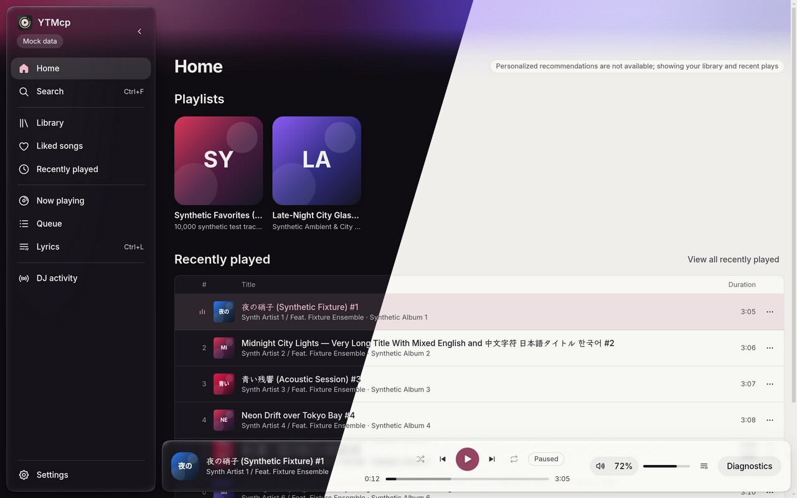
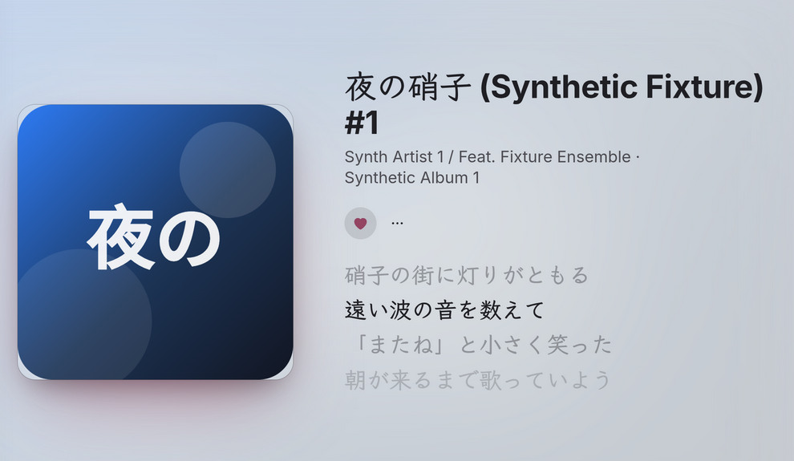
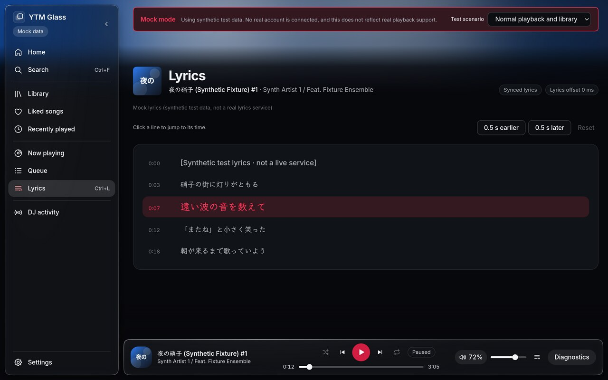

<p align="center">
  
</p>

<h1 align="center">YTMcp</h1>

<p align="center">
  <b>An AI DJ for your YouTube Music.</b>
</p>

<p align="center">
  Tell your agent what you're in the mood for. It picks the songs, keeps the queue going and remembers what you like, while you get on with your game.<br>
  Touch a key and you're in charge again.
</p>



<p align="center"><sub>Night on the left, day on the right. The screenshots use the built-in test library, which is why the covers are just initials.</sub></p>

## Just talk to it

```
Be my DJ for the next couple of hours. Start with something like Nujabes and drift from there.
```

```
That's too sleepy. Something with more drive, but no vocals, I'm concentrating.
```

```
Play the album this song is from, after this one finishes.
```

```
Remember I don't want anything from this artist in the background while I'm gaming.
```

```
No Christmas songs today, please.
```

That's the whole remote control. The agent you already talk to, Claude Code or anything else that speaks MCP, does the talking. YTMcp hands it the music.

## What your DJ does

- **It keeps the music going.** It gets a nudge before every song ends, and when the queue runs low it finds what comes next before the silence does.
- **It listens to how you listen.** Skip a song and it notices. Say "less of this" or "more like that" and it writes it down. Those notes stay on your computer, and you can read or delete every one of them.
- **It knows what kind of day it is, if you let it.** Friday night, a slow Sunday morning and New Year's Eve each get their own set. Switch it on for an agent in Settings and it gets the time, the day, the holidays where you live and a city you pick for the mood. It never looks up where you actually are. Say "not today" and that holds until midnight, then it lets go.
- **It knows when to be quiet.** Now and then it asks how the music is going. Ignore it and it asks less. Tell it to pipe down, or to chat more, and it will.
- **You're always in charge.** Pause, skip or reorder with your keyboard's media keys, the window or the tray, and your move beats anything the agent was about to do. No "are you sure?" pop-ups. You were sure. You pressed the key.
- **Your account is safe with it.** Playing and queueing are free for it. Liking songs and making playlists need your permission when you connect the agent, and stop at a daily limit. Editing a playlist you already have needs a separate, time-limited permission for that playlist only. Whatever it changes, it checks with YouTube Music before calling it done.
- **It's the real YouTube Music.** Your account, your subscription, the official player doing the playing. Nothing is downloaded.
- **And it's a proper player when you want one.** Search, your library, the queue, lyrics that follow the song, a day look and a night look, in English or Chinese.

<table>
  <tr>
    <td width="50%"></td>
    <td width="50%"></td>
  </tr>
  <tr>
    <td><sub><b>Now playing.</b></sub></td>
    <td><sub><b>Lyrics that follow the song.</b> Click a line to jump there.</sub></td>
  </tr>
</table>

## Get started

YTMcp is made for Arch-based Linux with KDE Plasma 6 on Wayland; other setups are untested. You need a YouTube Music account and an AI agent that speaks MCP, such as Claude Code.

**1. Install it.** Download `ytmcp-1.2.0-1-x86_64.pkg.tar.zst` from [Releases](https://github.com/swaggypatrol/ytmcp/releases) and install it with pacman:

```sh
sudo pacman -U ytmcp-1.2.0-1-x86_64.pkg.tar.zst
```

Or build the Arch package from this repository (prerequisites in [docs/building.md](docs/building.md)):

```sh
pnpm install --frozen-lockfile
just package
sudo pacman -U packaging/out/ytmcp-*.pkg.tar.zst
```

Coming from YTM Glass, the old name? Quit it first, and say yes when pacman offers to replace it. Your settings, sign-in and library come along.

**2. Sign in.** Start YTMcp from your app launcher. While you're signed out it offers to open the official YouTube Music page: sign in there, on Google's own page. YTMcp never asks for or records your password.

**3. Introduce your agent.**

```sh
ytmcp register --principal claude-dj --grant dj
claude mcp add ytmcp -s user -- /usr/bin/ytmcp \
  --credential-file ~/.config/ytmcp/control-credentials/claude-dj.json --allow-background-start
```

Restart YTMcp once after this first registration. `--grant dj` lets the agent play, queue and keep taste notes. Add `--grant record` if it may also like songs and make playlists. With `--allow-background-start` the agent can wake the player without opening a window, so your game stays in front. Other agents take the same command; see [docs/mcp.md](docs/mcp.md).

**4. Talk to it.** "Be my DJ tonight."

## Unofficial

YTMcp is not affiliated with, endorsed by or sponsored by Google or YouTube. "YouTube" and "YouTube Music" are trademarks of Google LLC. The official web player plays every song, you sign in yourself on Google's own page, and no music is downloaded or stored. Use it in line with the YouTube Terms of Service and your YouTube Music subscription.

## Learn more

- [How the DJ decides when to speak](docs/ai-dj.md)
- [Everything the agent can do, its permissions and limits](docs/mcp.md)
- [Building, testing and packaging](docs/building.md)
- [How it works inside](docs/architecture.md)
- [The interface and its design](docs/design/liquid-glass.md)
- [Known issues](docs/known-issues.md) and the [changelog](CHANGELOG.md)

## License

[MIT](LICENSE). Third-party notices are installed with the package. The music belongs to the people who made it. Go buy a record.
