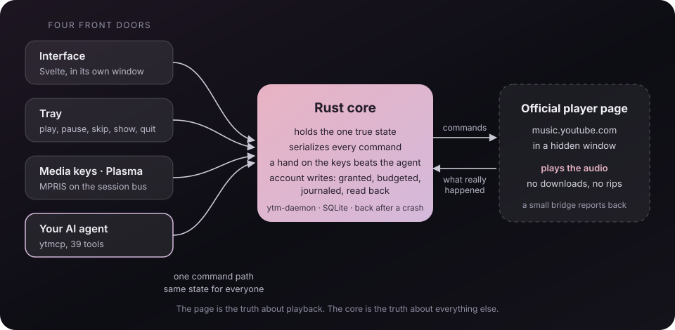

# Architecture

YTMcp has four parts: a thin Electron host, a hidden window with the official YouTube Music web player, a Rust daemon that holds all application logic, and a Svelte interface. The page is the authority on what actually plays; the Rust core publishes the one application state that the interface, MPRIS and MCP clients all read.



The window, the tray, the media keys and the agent all go through the same core, so they always agree on what is playing, and a manual action always wins over an agent's pending one.

```
 MCP client (agent) ── stdio ──▶ ytmcp ── control.sock (0600) ──────────┐
                                                                        ▼
┌───────────────────────────── ytm-daemon (Rust) ─────────────────────────────┐
│ ControlService: grants, operation journal, account writes, DJ prompts       │
│ CoreEngine (single actor): playback projection, queue mirror, commands      │
│ SQLite (settings, journal, history, caches) · catalog · lyrics · MPRIS      │
└──────────────┬───────────────────────────────────────────────▲─────────────┘
     stdout NDJSON (player.command, state)          stdin NDJSON (bridge.*, ui.*)
               ▼                                               │
        Electron main process: starts the daemon, forwards frames, owns windows
               │                                               ▲
               ▼                                               │
   Player window: music.youtube.com                 Main window: Svelte UI
     page shim (main world) + bridge (isolated world)
```

## Processes and channels

| Process | Role |
| --- | --- |
| Electron main | Starts and supervises `ytm-daemon`, forwards frames between the daemon, the player page and the interface, manages windows, the tray and the session broker. If the daemon exits unexpectedly it pauses and mutes the page, restarts the daemon (once per session; a second crash is fatal) and reinjects the bridge. |
| Player window | Loads `music.youtube.com` in a persistent, isolated session partition. It is hidden by default; closing it only hides it. |
| Main window | Loads the local interface from the app's own scheme in an ephemeral partition. It makes no external requests and never sees credentials. |
| `ytm-daemon` | The only business core. Communicates with the host over inherited stdin/stdout. |
| `ytmcp` | One process per MCP client; connects to the daemon's control socket for each tool call. |

The host and daemon exchange newline-delimited JSON (one frame per line, UTF-8). Stdout carries protocol frames only; diagnostics go to stderr as redacted structured logs. Frames are limited to 1 MiB and checked before parsing; at most 128 requests may be pending and at most 64 playback commands queued, beyond which the daemon answers `BUSY`. Integers stay within the JavaScript safe range, and volume is always 0.0 to 1.0.

Each channel accepts only its own message families:

| Channel | Allowed | Refused |
| --- | --- | --- |
| Interface → host/core | `ui.*`: queries, subscriptions, player actions, settings, explicit account writes | identity changes, cookies, arbitrary methods or URLs |
| Core → interface | normalized snapshots, state deltas, command results, invalidations | credentials, raw site responses |
| Host ↔ core | lifecycle, window control, session material, player commands and events | anything not declared for the role |
| Bridge → host/core | `bridge.*`: ready, observations, queue, health, structured errors | file, process or system access, settings |
| Core/host → bridge | a fixed set of music operations and bounded snapshot requests | arbitrary JavaScript, generic eval, arbitrary fetches |

Session material for catalog requests exists only between the Electron main process and the daemon, and its `Debug` form is redacted so it never reaches logs. The schema is generated from `crates/protocol` into `packages/protocol/schema/protocol.v1.schema.json` and TypeScript types with `just gen-protocol`; the external control protocol is generated from `crates/control-api` with `just gen-control`.

### Epochs and revisions

Three lifetimes are kept apart so stale messages can be recognized:

- `coreEpoch` changes when the daemon restarts; subscriptions, pending commands and revision baselines start over.
- `bridgeEpoch` changes when a new page document hands over; old page sequence numbers, observations and queue entry identities are dropped.
- `accountEpoch` changes on sign-in, sign-out, account switch or expiry; private queries and account writes from an older epoch are refused.

Each producer numbers its frames within its own epoch. The interface installs its listener before subscribing; the core sends the snapshot at revision R before any delta R+1. On a new core epoch, a gap or an unknown schema the interface drops its deltas and requests a fresh snapshot.

## The official page bridge

Each time the player page finishes loading, the host injects two scripts:

- The **page shim** runs in the page's main world, where it can call the official player object and the queue handlers the page itself uses.
- The **bridge** runs in an isolated world and is the only part that talks to the host. Page scripts cannot forge its messages, and the shim exposes no generic evaluation.

Only `bridge/` depends on the page's DOM, private objects or request shapes.

**Observation.** The bridge asks the shim for a page snapshot whenever media events fire (position at most once a second), when the player bar or queue DOM changes (debounced 100 ms), on in-page navigation, and on a 12-second health check. Playback state comes from the player API, falling back to the media element. Every refresh reports playback; the queue is reported when it changes. A *track instance* changes when a new video loads or the same video reloads, not on a seek.

**Commands.** The engine writes `player.command` frames; the host forwards them and the bridge validates them before handing them to the shim:

| Command | How it runs on the page |
| --- | --- |
| play, pause, seek, volume | the official player API |
| play a song, or a playlist or album from a position | in-page navigation to the watch URL, then play if needed; waits until the page reports the requested context |
| play next, add to queue | the same handlers as the page's own "Play next" and "Add to queue" menu items |
| remove, move, clear upcoming | dispatched to the page's queue state after checking the order and the selected entry |
| autoplay toggle | clicked only when the toggle matches the page state |

**Settlement.** A command counts only when its effect is observed. Basic controls have 8 seconds to show their effect and playback of a target has 15; after that, a command that may have reached the page settles as indeterminate rather than failed. Nothing with an unknown effect is retried automatically.

**Queue mirror.** The mirror holds up to 200 entries around the selected one. The page's autoplay suggestions are not mirrored; the mirror only notes that an autoplay tail exists. Entries are identified by occurrence, never deduplicated by video ID.

## The Rust core

### Engine actor

`CoreEngine` (`crates/core/src/engine.rs`) is a single-threaded actor that owns the playback projection, the queue mirror and the command queue. The interface, tray, MPRIS and the control service all submit commands through it, so they share one order and one state. The projection keeps observed facts and pending commands separate; an optimistic value in the interface is marked pending and never overwrites an observation. Repeated command IDs within a core epoch return the original result (results are kept for 10 minutes).

### Commands and fences

Every playback command an MCP client sends carries a `PlaybackFence` (`crates/core/src/commands.rs`): the account scope and epoch, the bridge epoch, a playback generation, the track instance and queue revision it was captured against, and a deadline (at most 20 seconds). The engine checks the fence when it accepts the command, when it starts it and right before the frame goes to the page. A command refused before dispatch reached nothing and is reported as refused, not unknown.

### Manual priority

Commands from the interface, tray, media keys and MPRIS are manual. Any manual command other than volume, mute, repeat and choosing an Up Next filter (which only re-steers YouTube Music's own suggestions) cancels the running and queued agent playback commands and invalidates their fences; if an agent command was in fact interrupted, a manual pause or stop goes to the front of the queue. Actions taken directly on the hidden official page are not seen as manual input.

### Control service

`ControlService` (`crates/core/src/control/`) serves the local control socket used by `ytmcp`: it checks grants and the registered account scope, journals every write in SQLite before sending it, runs queue and account writes, applies daily account limits, settles interrupted writes after a restart and produces the DJ prompts. See [mcp.md](mcp.md) and [ai-dj.md](ai-dj.md).

### Storage

`crates/storage` uses the XDG directories under the name `ytmcp`:

| Location | Contents |
| --- | --- |
| `$XDG_CONFIG_HOME/ytmcp/` | `settings.json`, the MCP registration list and per-client credential files |
| `$XDG_DATA_HOME/ytmcp/ytmcp.db` | SQLite (schema v7): account epochs, operation journal, local history, taste notes, lyric offsets, catalog and lyrics caches |
| `$XDG_DATA_HOME/ytmcp/electron-profile/` | the official page's browser profile and sign-in session |
| `$XDG_CACHE_HOME/ytmcp/covers/` | the cover cache; clearing the cache never signs you out or touches settings |

Before a migration the daemon backs the database up next to it. `YTMCP_DATA_DIR` moves all of this under one root, which the tests use.

### Catalog and lyrics

`crates/ytm-data` reads and writes the YouTube Music catalog with the session material of the app's own signed-in player session, behind the `MusicCatalog` port. Pages use opaque cursors and at most 100 items per request. Private content is tied to the account scope it was read with. `crates/lyrics` chooses between official lyrics and LRCLIB, matches tracks and parses LRC; per-track offsets are stored locally.

### MPRIS

`crates/mpris` publishes `org.mpris.MediaPlayer2.ytmcp` with metadata, a local cover URI for the current track, and the standard controls, which enter the engine as manual commands. Without a current track, MPRIS does not offer play.

## The interface

The Svelte interface (`ui/`) renders snapshots and catalog pages from the core and sends `ui.*` requests through a preload that exposes a fixed API. It covers home, search, library, playlists, albums, artists, the queue, lyrics, settings, diagnostics and an activity view that lists pending account requests and recorded DJ taste notes. Strings live in `ui/src/lib/i18n/`; English is the default and Chinese (zh-CN) is a selectable translation.

The sidebar, the floating player bar and popovers use the liquid glass material and the glass icon set; see [design/liquid-glass.md](design/liquid-glass.md). Reduced transparency, reduced motion and forced colors are honored, and the app's own settings can force the first two.

## Security boundaries

- Renderers are sandboxed with context isolation. Chromium uses the system's user-namespace sandbox; no security control is disabled.
- There is no remote debugging port and no network listener. The MCP control socket is a 0600 Unix socket under `$XDG_RUNTIME_DIR/ytmcp/` and accepts only registered clients.
- Credentials come only from the app's own player session, stay in memory outside the browser profile, and never enter arguments, environment variables, logs or fixtures.

## Project layout

| Path | What it is |
| --- | --- |
| `apps/desktop/` | The Electron host: windows, sessions, tray, the daemon process and the IPC guards |
| `bridge/` | The small shim injected into the official player page. The only code that knows what that page looks like inside. |
| `crates/core/` | The engine: one actor, every command, the control service for agents and the DJ cues |
| `crates/daemon/` | `ytm-daemon`: wires the core to stdio, SQLite, the catalog, lyrics, MPRIS and the control socket |
| `crates/ytm-data/` | YouTube Music catalog reads and writes |
| `crates/storage/` | SQLite schema, migrations, the operation journal and the cover cache |
| `crates/lyrics/`, `crates/mpris/` | Lyrics sources and LRC parsing; the MPRIS service |
| `crates/protocol/`, `crates/control-api/` | The host wire protocol and the local control protocol |
| `crates/mcp/` | `ytmcp`: the MCP stdio adapter and the `register` command |
| `ui/` | The Svelte interface and the liquid glass |
| `packages/protocol/` | Generated JSON Schema and TypeScript types |
| `packaging/` | PKGBUILD, launcher, desktop entry, icon and license notices |
| `tools/` | MCP live checks, QA and probe tools (the README screenshots come from the glass probe), packaging and release scripts |
| `tests/`, `fixtures/` | Process, desktop and end-to-end tests; the synthetic library |
