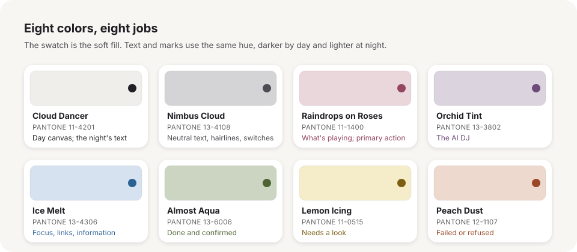
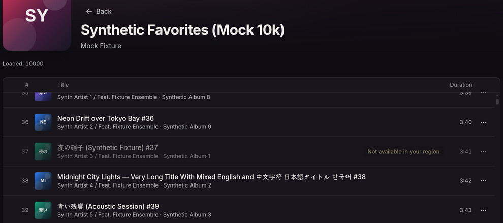

# Liquid glass

The interface uses one refractive glass material at three levels: the sidebar (radius 22), the floating player bar (radius 22) and overlays (menus, dialog panels and toasts; radius 16, a toast is a capsule). The levels differ in two things only: overlays float higher on a heavier shadow and sit on a more solid base, so that what is written on them stays readable over any content. The surfaces never overlap. A dialog's full-window scrim is a plain translucent color with no blur.

Implementation: `ui/src/lib/glass/` (`glass.css`, `liquid-glass.ts`, and the tone audit in `__tests__/tone.test.ts`). Probes: `tools/probes/glass/`.

## Summary

- `backdrop-filter: url(#filter)` works in the pinned Chromium, so refraction, dispersion, frost and tone mapping run in **one SVG filter per surface**.
- The refraction field is a small bitmap assembled from nine pieces (four corner tiles and four one-texel edge strips over a neutral flood); each strip runs on under its corners, so the rim stays continuous at fractional device pixel ratios. A full-size bitmap through `feImage` was tried first and dropped, because its per-frame cost grows with bitmap size times the number of references (median frame time rose to 25 ms in a prototype); the pieces are a few kilobytes and cost nothing measurable (see Measurements).
- Text contrast on glass is constrained by construction: a unit test derives the worst case from the tokens in `glass.css`, and screenshot scans of the real interface found no text below 4.5:1 and no icon below 3:1 in either theme, including over adversarial backgrounds.
- In scroll tests of the real interface, the 50th, 95th and 99th percentile frame times matched the reduced-transparency (opaque) baseline, and long frames stayed under 1% in every run (0.85% at most, in one page-scroll run; see Measurements).
- Nothing animates while the glass is idle: no rAF loop, timer or CSS animation runs.

The glass does not flip between dark and light depending on what is underneath. Its palette follows the app theme; within one palette, its tone changes continuously with the brightness below.

## Layers of the window

Everything on screen sits in one of five layers, and `z-index` takes only these values (`--z-*` in `ui/src/styles/base.css`); no component makes up its own:

| Layer | `z-index` | What |
| --- | --- | --- |
| L1 ambient light | 0 | A blurred wash of the current page's main cover (or the playing track's, or the theme's three colors), fixed to the window outside the scroll container, so it never scrolls. A new light fades in over 900 ms on top of the old one; while music plays it breathes once every 9 s, and it is still when paused, hidden or under reduced motion. |
| L2 content | 1 | The one vertical scroll container. It spans the whole window, so content passes under the glass. |
| L3 glass | 30 | The sidebar and the player bar. |
| L4 overlays | 40 | Menus, popovers and toasts. A toast sits at the bottom centre of the content area, 12 px above the player bar, and never enters the layout flow. |
| L5 modal | 50 | The dialog scrim and the dialog. |

A page change cross-fades the scroll container alone: the view transition is started on that element (`Element.startViewTransition`, `App.svelte`), not on the document, and nothing carries a `view-transition-name`. Its snapshots therefore paint inside L2, under the glass, and nothing above L2 is captured. That matters for the material: a captured glass surface has no backdrop and paints as an opaque slab, and a surface inside a named ancestor (a backdrop root) has nothing to blur. A document-wide transition with the sidebar and player bar named turned both into flat slabs for the 220 ms of every page change; one with them unnamed let the ambient light and the page cover the sidebar.

## Material layers

From bottom to top:

| Layer | Implementation | Purpose |
| --- | --- | --- |
| Shadow | `box-shadow` on `.lg`: a one-device-pixel contact line (`--lg-px`), a near shadow and an ambient shadow; overlays use the higher `--lg-shadow-raised` | Lifts the glass off the content |
| Lens | `backdrop-filter: url(#lg-lens-N)` on `.lg` | Refraction, dispersion, frost and tone mapping in one pass |
| Tint | `background-color: var(--lg-tint)` on `.lg[data-lg-lens]`, drawn over the filter result; the heavier `--lg-tint-plain` when no lens is active | The palette base and part of the contrast bound |
| Rim | `.lg::before` (a masked ring one device pixel wide) and inset shadows (a top light line, a bottom dark line and a soft glow along the rim, the sheen) | Bevel shading and thickness; the refraction, not the ring, marks the edge |
| Content | ordinary children, colored with `--lg-text-*` | Text and controls |

Inside the filter, in order: the displacement field, assembled from nine pieces over a neutral `feFlood` (four edge strips, then four corner tiles over them, each an `feImage`); an even frost blur of the backdrop; three `feDisplacementMap` passes of that frost with slightly different scales for R, G and B (dispersion); a saturation boost; a large blur of the backdrop, refracted through the same field, that measures the local mean brightness; the tone mapping; and the glint. Blur comes before refraction everywhere, so the glass is frosted and bends at the same time. The filter must use `color-interpolation-filters="sRGB"`; the default `linearRGB` distorts the displacement map.

## Refraction field


The glass is modeled as a slab whose edge is a rounded lens, viewed straight on. The flat body does not bend light; on the rim, rays bend inward, so the displacement always points into the shape, is strongest at the outline and falls to zero where the glass turns flat.

- **Cross-section.** Over the rim, `t` runs from 0 at the outline to 1 at `--lg-bezel` inside it, and the surface rises as `1 − (1 − t)³`: steep at the outline, flat where it meets the body. For the small angles involved, refraction moves a ray sideways in proportion to the slope, so the offset is `--lg-reach × (1 − t)²` along the inward normal.
- **A thick lens, not a smear.** Depth `x` shows what lies at `x + reach × (1 − x/bezel)²`. With `reach` about 1.4 × the bezel, the outer part of the rim shows the content just inside it upside down and compressed (about 1.8× at the outline), the inner part shows it upright and magnified, and the two meet at one turning line, as at the rim of real thick glass: text passing under an edge reappears mirrored in it. The frost blurred in beforehand keeps the turning line soft. (An earlier field took the Sobel gradient of a blurred rectangle; it showed a strip only about 3 px wide across the whole rim, which read as straight smears.) `field.test.ts` keeps exactly one turn, an inverted but readable band at the outline and no sample deeper than the reach.
- **Curved corners.** The direction is the outline's normal. Around a corner it is radial, using the superellipse `|x|⁴ + |y|⁴` that matches CSS `corner-shape: squircle` (a circle where squircles are unsupported), with the element's real `border-radius`, so lines bend around the corner instead of breaking at it.
- **Encoding.** Red and green carry the offset as 127.5 ± 127.5 × offset / reach, blue is unused (neutral), alpha is opaque. `feDisplacementMap` moves by `scale × (C/255 − 0.5)`, so `scale = 2 × reach`.

A corner tile covers the curve and the rim beside it, `max(radius, bezel) + 1` px square at one texel per CSS px; an edge strip is one texel thick, stretched along its edge (`preserveAspectRatio="none"`), because the field along a straight edge does not change. Each strip runs 1 px past both ends, under the corner tiles, which are painted after it (`pieceBoxes()`): at 125% and 150% a tile's edge falls inside a device pixel, the tile covers that pixel only in part, and without the strip beneath the neutral flood showed through there. The glint is computed from the field, so that gap broke the rim highlight for one device pixel beside every corner (on the player bar's top rim at 125%, luminance 112 → 103 → 113 across it); with the overlap the same scan reads 112, 113, 113. `field.test.ts` checks that every point of the rim lies at least half a CSS pixel inside some piece. The pieces depend only on the radius, the bezel and the corner shape, are generated once with a canvas and cached, and are reused across sizes: a resize only moves them. One filter per surface uses `userSpaceOnUse`; a `ResizeObserver` rewrites the filter region and the piece positions. `feDisplacementMap`'s `scale` and the pieces are in CSS pixels, independent of the device pixel ratio.

## Readability

- **No blur outside the glass.** Content stays sharp until it actually passes under a surface. An earlier scroll-edge strip that blurred and dimmed content above the player bar was removed: it made text look out of focus before it reached the glass.
- **One even frost.** The whole surface is the same material: the backdrop is blurred by `--lg-frost` (5 px) and then refracted, with no clearer rim and no cloudier zones behind text. An earlier version kept the rim clear and put heavily blurred plates under the body and the labels; the change from one to the other read as an abrupt seam. A 5 px blur already flattens body-size text behind the glass into soft color, and the tone stage bounds what is left. Of the two replacements measured, a fully clear lens with glows around the glyphs failed 27 screenshot contrast checks; the even frost failed none.
- **Tone mapping.** A wider refracted blur (`--lg-mean-blur`) measures the local brightness. Dark palette: `out = lens × (a − b · Y(mean))`; light palette: the mirrored form `1 − (1 − lens) × (a − b · (1 − Y(mean)))`, with `a = --lg-tone-gain`, `b = --lg-tone-adapt` and `Y` the Rec. 709 luma of the sRGB values. The brighter the content below, the more a dark glass darkens it.
- **Tone audit.** Over an even backdrop the output depends only on its color, so `tone.test.ts` searches 25³ backdrop colors × sheen × three fills (none, hover, selected) using the same `toneMatrix()` as the runtime and the token values parsed from `glass.css`. It fails if any text color drops below 4.5:1 or any icon color below 3:1, with a 1.5% margin, because a screenshot once measured 1.2% below the model. The worst backdrop for the dark palette is a saturated color rather than white.
- **Text colors.** Glass has its own tokens, and `.lg` remaps the general content tokens (`--text-*`, `--accent`, `--agent`, `--status-*`, `--focus-ring`, `--bg-*`) to them, so a component on glass cannot pick an unaudited color. Accent color is used for icons and small marks only; the current item is shown with a selected fill, primary text and an accent icon. Primary buttons have their own fill and text pair.

The model covers even backdrops; textured ones are covered by the screenshot scans below.

## Highlights, dispersion and shadow

- **Glint.** A thin specular line along the outline comes from the same field: its alpha is how much the outline faces the light (upper left) times how strongly the rim bends there, raised to the 4th power so only the outer few px remain. Edges facing the light get `--lg-glint`, the opposite ones `--lg-glint-return` (a quarter) of it. Its strength also follows the local mean brightness, from `--lg-rim-over-dark` over black to `--lg-rim-over-bright` over white, so it neither glares over bright covers nor vanishes over dark ones; highlights are only ever reduced, never raised to make an edge clearer. It is drawn last, over the tone-mapped glass, and only in the outer few px, where no text sits.
- The CSS rim is one device pixel wide (`--lg-px`): a light centred above the upper-left corner that fades along both edges, a return on the far corner of at most a quarter of it, and a faint line that closes the ring, following the shape through `border-radius: inherit` and `corner-shape: inherit`. It keeps an edge where the filter is off.
- Three inset shadows shade the bevel: a light top line, a dark bottom line and a faint glow along the rim.
- Dispersion scales the three displacements by `reach·(1+δ)`, `reach` and `reach·(1−δ)` with `δ = --lg-dispersion`, so the rim shows a faint red and blue fringe where it magnifies most.
- `--lg-shadow` (sidebar, player bar) and `--lg-shadow-raised` (popovers) lift the glass; the contact line keeps an edge on light content.

## Motion

| Action | Implementation |
| --- | --- |
| Hover | `.lg-press:hover` fills `--lg-fill-hover` over 160 ms |
| Press and release | `.lg-press:active` scales to `--lg-press-scale` in 90 ms and springs back with `--lg-ease-spring` |
| Overlay entry | `.lg-overlay` scales from 0.92 to 1 with an ease-out over 245 ms, with separate tracks for frost, content, tint and rim |
| Overlay exit | Toast expiry dissolves over 360 ms. Menu and dialog closes, transient toast actions and toast replacement compress the same order to 160 ms |
| Pointer highlight | `pointermove` writes `--lg-light-shift` at most once per frame: the rim light moves at most 8% of the surface's width either way and never leaves the upper left; nothing is scheduled while still or hidden |
| Page change | The scroll container cross-fades over `--duration-normal` (220 ms); the glass is not part of the transition (see Layers of the window) |
| Sidebar collapse | A glide over `--duration-slow` (320 ms), below |
| Reduced motion | `prefers-reduced-motion` or the app setting: no scaling or movement, only color and opacity transitions; no pointer highlight, no page cross-fade |

The 240 ms press spring (`--lg-ease-spring`) is a 13-point CSS `linear()` step response. It ends after the first overshoot and return, when the remaining movement of a small control is under a third of a pixel.

**Overlays.** The surface starts at full opacity with refraction in place. An even frost reaches its 5 px resting value in 150 ms. The content comes into focus over 245 ms, while tint and the specular rim reach their resting values over 280 ms. Leaving softens the content and removes tint first, clears the frost after those tracks begin, scales to 0.91, and finishes on the rim. Closing releases pointer interaction and restores focus immediately. A menu or dialog reopened during its exit reverses the same surface's transitions. Reduced motion keeps a 140 ms fade in both directions. Reduced transparency uses that fade over a solid surface.

Overlay motion is an explicit exception to the rule that transitions longer than 100 ms animate only transform and opacity. The renderer samples the three CSS optical tracks while they are changing and updates the SVG blur, tone gain, saturation and glint on that surface. The CSS tint, shadow and content blur also change. The lens displacement stays constant, and the runtime stops requesting frames when the optical transitions finish. Sidebar and player-bar optics stay static.

**Collapse.** The content area's left edge switches in one step, so the page lays out once. What follows the sidebar's edge (the sidebar's frame and panel, the player dock and bar and the page column) then glides by `transform` only, driven by one registered length, `--sidebar-edge`: the sidebar's frame is a rounded clip that slides while the glass panel inside slides back by the same amount, so the panel, its left rim and every icon stay where they are and only the clip's right edge moves. Every icon's centre, and the mark's, sits 36 px from the panel's left edge, the middle of the 72 px collapsed panel, so no icon moves by a pixel (`phase2-sidebar.test.ts` derives it from the stylesheet). For the move both surfaces hold the plain blur (`holdPlainBlur`), whose heavier tint they cross-fade to; the lens comes back in one step when the panel's own transition ends, or 120 ms after `--duration-slow` if no `transitionend` arrives. A second click mid-way turns back from where the panel is. Reduced motion skips the glide: the labels fade out, then the edge switches. The earlier width animation, which resized both lenses on every frame, missed a refresh on 16.4% of frames; the glide's numbers are under Measurements.

## Layout tiers

The page column adapts to the width of the content area (the window less the sidebar), not the window, through `@container content (min-width: …)`: compact under 880 px (20 px margins), regular to 1399 (32 px), wide to 2099 (48 px, the column stops at `--page-max-wide`) and ultrawide from 2100 (56 px). The glass does not change between tiers; the player bar's controls give way by its own container width: the volume bar first (the mute button and the wheel still set the volume), then the quality badge under 810 px, the like button under 776 px and the lyrics button under 544 px.

## Icons

The interface icons (play, pause, previous, next, volume, lyrics, settings and the rest) come from a glass-styled SVG icon set that follows the same design language as the material. On glass they are held to the 3:1 icon contrast like any other icon. They are rendered through `ui/src/lib/components/Icon.svelte`.

## Tokens

Optics, read by `liquid-glass.ts`:

| Token | Default | Meaning |
| --- | --- | --- |
| `--lg-bezel` | 22px (sidebar, player bar and popover 24) | Width of the curved rim |
| `--lg-reach` | 30px (sidebar 34, player bar and popover 33) | Peak displacement at the outline; about 1.4 × the bezel |
| `--lg-dispersion` | 0.03 | R and B displacement relative to G |
| `--lg-frost` | 5px | One even frost over the whole surface, applied before refraction |
| `--lg-glint` | 0.4 dark, 0.75 light | Peak opacity of the specular line on the edges facing the light |
| `--lg-glint-return` | 0.25 | The opposite edges, as a share of it |
| `--lg-rim-over-dark`, `--lg-rim-over-bright` | 1.15, 0.7 | The line's strength over a black and over a white local mean |
| `--lg-mean-blur` | 13px | Radius of the local mean brightness read by the tone stage |
| `--lg-saturation` | 1.45 | Saturation |
| `--lg-tone-gain`, `--lg-tone-adapt` | 0.8, 0.6 | Tone mapping `a` and `b` |
| `--lg-scheme` | dark or light | Selects the tone formula; follows the theme |

Surface colors exist in a dark and a light set: `--lg-tint`, `--lg-tint-plain`, `--lg-solid`, `--lg-text-primary`, `--lg-text-secondary`, `--lg-accent`, `--lg-agent`, `--lg-accent-fill`, `--lg-on-accent-fill`, `--lg-status-success/warning/danger/info`, `--lg-focus-ring`, `--lg-hairline`, `--lg-fill-hover`, `--lg-fill-active`, the rim, sheen, bevel and shadow tokens, `--lg-rim-width` and `--lg-fallback-blur`. Motion uses `--lg-duration-*`, `--lg-press-scale`, `--lg-ease-spring`, `--lg-morph-from`, `--lg-morph-to` and `--lg-morph-content-blur`.

After changing a tint, tone, sheen, fill or text token, run `pnpm --filter @ytmcp/ui test`: the tone audit fails rather than letting contrast degrade silently.

## Fallbacks

| Condition | Behavior |
| --- | --- |
| The runtime has not mounted, or `CSS.supports('backdrop-filter', 'url(#x)')` is false | CSS defaults apply: `blur(--lg-fallback-blur) saturate()` with the much heavier `--lg-tint-plain`; rim and shadow stay. `liquid-glass.ts` adds `data-lg-lens` once the lens is active, which switches to the light tint. |
| `prefers-reduced-transparency: reduce` or the app setting | `backdrop-filter: none` on a solid `--lg-solid` base. The SVG lens is bypassed. |
| `forced-colors: active` | `Canvas` background with a 1 px `CanvasText` border, no shadow or highlight, `Highlight` outlines for the selection; sliders are drawn with system colors because forced colors remove their gradient tracks. |
| `prefers-reduced-motion: reduce` or the app setting | See Motion. |

## Measurements

The contrast scans and frame timing ran the real interface in mock mode (`YTMCP_MODE=mock`, temporary XDG directories, synthetic covers and a 10,000-row playlist) at 2x scaling on a 120 Hz display. Each scene was scanned per device pixel with glyphs hidden, then again over 12 adversarial backgrounds (white, black, six saturated colors, stripes of 2, 13 and 48 px, half white and half magenta). Every text measurement met 4.5:1 and every icon 3:1, in dark, light and reduced-transparency modes. At the minimum window size of 900×600 the player dock is 630 px wide: the volume bar, the quality badge and the like button give way by design and every other control fits; Diagnostics opens from Settings.

Frame timing scrolled the virtual list under the player bar for 60 seconds per scene. Dark, light, dialog-open and opaque baseline runs all had the same 50th, 95th and 99th percentile frame times, one refresh interval or just above it, with long frames below 0.06%. The glass costs at most a few dozen single missed refreshes per minute; it cannot be shown to be zero. With the nine-piece field and one even frost (2026-11-23, 30 seconds per scene, 2x, 120 Hz): the 10k list under the bar, page scroll, the light theme and the opaque baseline all ran at a 50th percentile of 8.3 ms and a 99th of 8.5 ms with no dropped frames; with the dialog open as a third surface, 0.08% of frames were dropped. The screenshot contrast sweep of the same build found no text below 4.5:1 and no icon below 3:1 in any mode.

On 2026-11-24 (after the field overlap, the scoped page transition and the moved Diagnostics entry; 2x, 120 Hz) the screenshot sweep measured 2,756 text and icon runs on glass in the dark theme, 2,770 in the light theme and 518 with reduced transparency, now including a toast over the 12 adversarial backgrounds and the playlist hero at the top of the page, and none was below its minimum; the lowest were 5.08:1 for sidebar and player-bar text and 3.29:1 for a sidebar icon, all over 13 px stripes. Frame timing ran 20 seconds per scene, twice. The 10k list under the bar (it now scrolls with the page), the light theme, a whole-page scroll of 100,000 px in 2.6 s legs (which now runs through the 10,000-row list) and their opaque baselines all ran at a 50th percentile of 8.3 ms and a 99th of 8.5 ms; in the second run these scenes dropped between 0% and 0.13% of frames, the glass and the opaque baselines alike. The first run's page scroll dropped 1.24% (0.85% long), and its Diagnostics-over-Settings scene (a third surface, a 642 px scroll range) 0.97%; in the second they were 0% and 0.17%, so single runs of this length vary by about a percent.

The overlay spike first animated the frost, tint and rim on one real mock toast. Over 12 cycles, the 95th-percentile frame interval was 8.4 ms on entry and 8.5 ms on dismissal at 2× scaling, with 2.58% and 3.38% of measured intervals missing a refresh. The backdrop retained its URL lens while the sampled frost rose from 0 to 5 px. These initial runs included startup and the scenario changes that created and cleared the toast.

The larger Diagnostics dialog needed a different shadow. A matched mock-window comparison measured 19.15% missed refreshes entering and 7.00% leaving with a moving box shadow, plus 17.28% and 3.77% with fixed SVG optics. Keeping the elevation shadow static while all five tracks moved brought the warm 95th-percentile interval to 8.4 ms both ways and missed refreshes down to 0.53% and 0%. The dialog uses this static elevation. The specular SVG glint and CSS rim still animate.

The first integrated muted mock run used Electron 45.4.1 and Chromium 156.0.8078.100 on native Wayland at 2× scaling, with an RTX 5090, NVIDIA driver 620.73.04 and an 8.34 ms refresh interval. The probe sampled renderer frame intervals during 12 toast cycles and six cycles each for the track menu and Diagnostics. Warm results exclude the first cycle.

| Surface | Entry p95 | Exit p95 | Missed refreshes, entry and exit |
| --- | ---: | ---: | ---: |
| Toast | 8.4 ms | 8.4 ms | 0.22%, 1.56% |
| Track menu | 8.4 ms | 8.4 ms | 0%, 0% |
| Diagnostics | 16.7 ms | 8.4 ms | 6.86%, 0% |

The warm Diagnostics entry had a 33.4 ms maximum, and the first cycle reached 75.1 ms. The preliminary toast spike and the later scenario-driven runs include the mock page refresh, so their long frames do not isolate the lens. The spring probe measured a single overshoot and rest at 249 ms for the play button and 246 ms for the sidebar item. Five reachable English mock toasts measured 276–389 CSS px, with single-line, unclipped text. The probe also verified same-surface reopen, immediate focus return, pointer pass-through, natural and explicit toast exits, and both system and app accessibility settings. The frame intervals do not describe actual presented frames or performance on a weaker GPU.

The seek span uses the width available with the sidebar open. Both sidebar positions share that span, so the time labels finish the glide with the transport. Opening the sidebar previously moved each label by 79 px at a 1024 px window and 91 px at 1080 px on the last frame. At 900, 960, 1024 and 1080 px, both directions with unknown or high mock quality measured 0 px of residual movement. The compact 630 px dock still gives the title 91 px.

The sidebar collapse was measured with `perf collapse`: six toggles 550 ms apart in a 4 s window, about half of it idle, over the 10k list. Five runs in three launches: the first of each launch, which includes warm-up, dropped 0.64%, 1.07% and 0.64% of frames with one long frame of 67 to 92 ms; the two warm runs dropped 1.48% and 0.84% (all but one of those single missed refreshes), at a 50th percentile of 8.3 ms. The width animation the glide replaced dropped 16.4%.

In the subsequent full verification at 119.9 Hz, warmed Toast and menu entry and exit measured 8.4 ms at p95. The warmed Diagnostics dialog measured 8.5 ms in both directions, with 5.0% of its entry intervals and 3.8% of its exit intervals missing at least one refresh. The longest scenario-driven Toast entry interval was 150.3 ms, including the mock refresh. In three additional sidebar runs, p95 was 8.4 ms each time, with 1.93%, 0.63% and 1.06% of intervals missing a refresh. These figures come from native Wayland on the RTX 5090.

A theme switch replaces the glass palette immediately. Sidebar labels read their text color directly from that palette. Previously they inherited the navigation button's interpolated color, which briefly made the letters almost disappear against the new background.

## Chromium behavior relied on

- A page change is a view transition scoped to the scroll container (`Element.startViewTransition`), which the pinned Chromium supports; where it is missing, or under reduced motion, the page switches at once.
- `backdrop-filter: url()` is Chromium-only. `feImage` pieces inside a backdrop filter and mirrored sampling beyond the element are not guaranteed by any specification, which is one reason Electron is pinned; rerun the `behavior` probe after upgrading it.
- `feDisplacementMap` and the default `feGaussianBlur` sample a mirror of the element's own backdrop beyond its edge rather than the real content outside; output is always clipped to the border box.
- Changing `scale`, `stdDeviation` and similar attributes repaints every element using the filter at once.
- During a `scale()` transition the backdrop filter stays active. Only the accessibility fallbacks fade the whole surface.

## Open risks

- The material has been measured on one high-end GPU only. Each surface's filter has about 30 primitives; the cost on weaker GPUs is unknown. Reduced transparency is the escape hatch.
- Appearance on an HDR display has not been judged by eye; all color results come from captured frames.
- Frame timing used rAF intervals with main-thread scrolling; compositor-thread wheel scrolling and presented frames (tracing) were not measured, nor real cover decoding with the hidden player page running.
- Dark glass over very bright content looks rather dark; that is the direct cost of keeping secondary text at 4.5:1.
- Hover contrast and the plain-blur fallback are covered by the audit's calculation only, not by screenshot scans.

## Reproducing

```sh
pnpm --filter @ytmcp/ui run build
pnpm --filter @ytmcp/desktop run build
node tools/probes/glass/run-probe.mjs shots     # screenshots, contrast scan, interaction and fallbacks
node tools/probes/glass/run-probe.mjs perf 60   # frame intervals
node tools/probes/glass/run-probe.mjs perf collapse # frame intervals of the sidebar glide only
node tools/probes/glass/run-probe.mjs look dark # page screenshots for visual review (add --force-device-scale-factor=0.625 or 0.75 for 125% or 150% on a 2x display)
node tools/probes/glass/run-probe.mjs transition # slowed page changes captured mid-way, both themes
node tools/probes/glass/run-probe.mjs tiers dark # every main view at the four layout tiers
node tools/probes/glass/run-probe.mjs flow      # volume wheel, Ctrl+L return, playback indicator
node tools/probes/glass/run-probe.mjs overlay --mute-audio # overlay tracks, frame intervals, input and press spring
node tools/probes/glass/run-probe.mjs overlay dialog-profile --mute-audio # compare the two dialog shadows
node tools/probes/glass/run-probe.mjs behavior  # Chromium behavior matrix on a synthetic page
```

Output goes to `tools/probes/glass/out/` or the directory set by `GLASS_PROBE_OUT`. The probe refuses to run outside mock mode, points every XDG directory at a temporary directory and never contacts `music.youtube.com`. Keep the window visible and the machine otherwise idle while timing frames.

## Palette



Both themes are built from eight Pantone pastels, and each one has a single job, so a color always means the same thing. The swatch itself is used as a soft fill; text, icons and marks use an ink of the same hue, darkened by day and lifted at night until it passes the contrast rules above.

| Swatch | Job |
| --- | --- |
| Cloud Dancer 11-4201 | The day canvas, and the night's text |
| Nimbus Cloud 13-4108 | Neutral text, hairlines, quiet surfaces, switches that are on |
| Raindrops on Roses 11-1400 | The accent: what's playing, the current row and page, the primary action, likes |
| Orchid Tint 13-3802 | The AI DJ: its page, its clients' names, its taste notes |
| Ice Melt 13-4306 | Focus rings, links and information |
| Almost Aqua 13-6006 | Done and confirmed |
| Lemon Icing 11-0515 | Attention: partly done, unclear, unavailable here |
| Peach Dust 12-1107 | Failed or refused |

The night canvas is a plum-tinted ink that leans toward Orchid Tint and Nimbus Cloud. A cover's own color still tints Now playing and Lyrics, clamped to the same pastel chroma so it reads as one more swatch. The swatches and roles live at the top of `ui/src/tokens.css`.

## Seek and volume

Seek and volume are flat rounded bars with no thumb (`ui/src/lib/components/ScrubBar.svelte`, styles under "Scrub bar" in `ui/src/tokens.css`). They take the text color of the surface they sit on: the color itself up to the value, the same color at 30% up to how far the track has loaded, and at 16% for the rest of the track. The loaded point comes from the official player's `getVideoLoadedFraction()` (per track; the media element's buffered ranges span earlier gapless tracks), reported in whole seconds as `bufferedMs`. Pressing thickens a bar from 4 to 6 px.

A transparent native `input type="range"` lies over the bar and does all the interaction, so the keyboard, screen readers, `aria-valuetext` and the test IDs work as they would on a slider. Its thumb is one pixel wide, which keeps the value mapping linear across the bar. Under forced colors the drawing is hidden and the system's own slider shows instead.

## Screens

The screenshots come from the glass probe (`node tools/probes/glass/run-probe.mjs look dark clean`) on the synthetic library; `clean` hides the mock-mode scenario banner.



A 10 000-track playlist is a virtualized list. A song the catalog marks as unavailable is greyed out before anyone clicks it (the synthetic library labels every 37th one as region-blocked).


Reduced motion and reduced transparency each have their own fallback; switches that are on use the neutral ink, not the accent.


At the minimum window size of 900 × 600 the volume bar, the quality badge and the like button give way (mute and the wheel still set the volume) and every other player control fits; Diagnostics opens from Settings.

