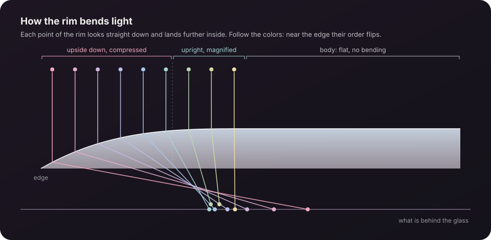
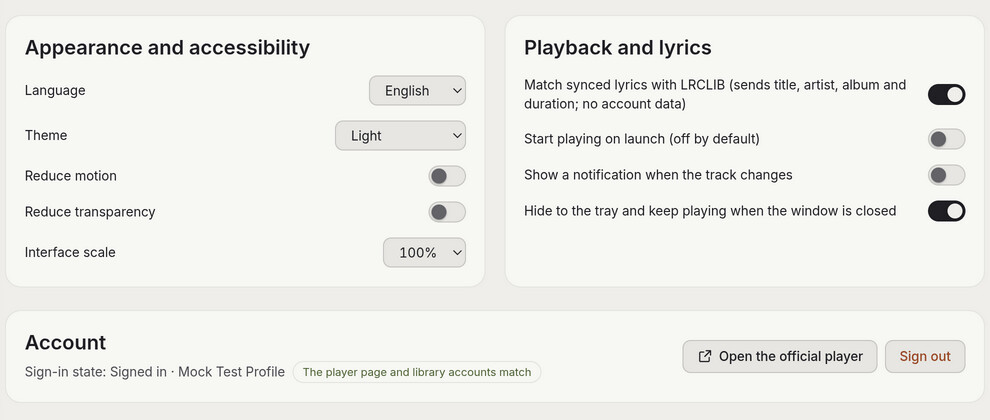
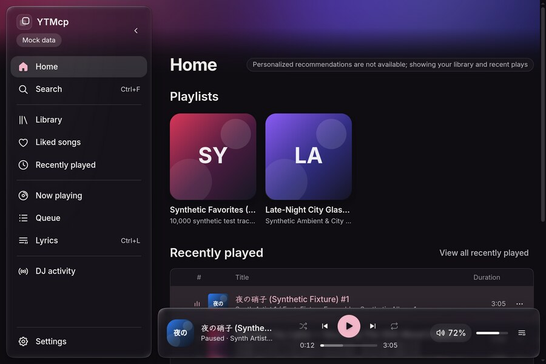

# Liquid glass

The interface uses a refractive glass material for three surfaces: the sidebar, the floating player bar and popovers (menus, popup panels and dialog panels). The surfaces never overlap. A dialog's full-window scrim is a plain translucent color with no blur.

Implementation: `ui/src/lib/glass/` (`glass.css`, `liquid-glass.ts`, and the tone audit in `__tests__/tone.test.ts`). Probes: `tools/probes/glass/`.

## Summary

- `backdrop-filter: url(#filter)` works in the pinned Chromium, so refraction, dispersion, frost and tone mapping run in **one SVG filter per surface**.
- The refraction field is a small bitmap assembled from nine pieces (four corner tiles and four one-texel edge strips over a neutral flood). A full-size bitmap through `feImage` was tried first and dropped, because its per-frame cost grows with bitmap size times the number of references (median frame time rose to 25 ms in a prototype); the pieces are a few kilobytes and cost nothing measurable (see Measurements).
- Text contrast on glass is constrained by construction: a unit test derives the worst case from the tokens in `glass.css`, and screenshot scans of the real interface found no text below 4.5:1 and no icon below 3:1 in either theme, including over adversarial backgrounds.
- In scroll tests of the real interface, the 50th, 95th and 99th percentile frame times matched the reduced-transparency (opaque) baseline, and long frames stayed far below 1%.
- Nothing animates while the glass is idle: no rAF loop, timer or CSS animation runs.

The glass does not flip between dark and light depending on what is underneath. Its palette follows the app theme; within one palette, its tone changes continuously with the brightness below.

## Material layers

From bottom to top:

| Layer | Implementation | Purpose |
| --- | --- | --- |
| Shadow | `box-shadow` on `.lg`: a 0.5 px contact line, a near shadow and an ambient shadow | Lifts the glass off the content |
| Lens | `backdrop-filter: url(#lg-lens-N)` on `.lg` | Refraction, dispersion, frost and tone mapping in one pass |
| Tint | `background-color: var(--lg-tint)` on `.lg[data-lg-lens]`, drawn over the filter result; the heavier `--lg-tint-plain` when no lens is active | The palette base and part of the contrast bound |
| Rim | `.lg::before` (a faint 1 px masked ring), `.lg::after` (a sheen) and inset shadows | Bevel shading and thickness; the refraction, not the ring, marks the edge |
| Content | ordinary children, colored with `--lg-text-*` | Text and controls |

Inside the filter, in order: the displacement field, assembled from nine pieces over a neutral `feFlood` (four corner tiles and four edge strips, each an `feImage`); an even frost blur of the backdrop; three `feDisplacementMap` passes of that frost with slightly different scales for R, G and B (dispersion); a saturation boost; a large blur of the backdrop, refracted through the same field, that measures the local mean brightness; the tone mapping; and the glint. Blur comes before refraction everywhere, so the glass is frosted and bends at the same time. The filter must use `color-interpolation-filters="sRGB"`; the default `linearRGB` distorts the displacement map.

## Refraction field



The glass is modeled as a slab whose edge is a rounded lens, viewed straight on. The flat body does not bend light; on the rim, rays bend inward, so the displacement always points into the shape, is strongest at the outline and falls to zero where the glass turns flat.

- **Cross-section.** Over the rim, `t` runs from 0 at the outline to 1 at `--lg-bezel` inside it, and the surface rises as `1 − (1 − t)³`: steep at the outline, flat where it meets the body. For the small angles involved, refraction moves a ray sideways in proportion to the slope, so the offset is `--lg-reach × (1 − t)²` along the inward normal.
- **A thick lens, not a smear.** Depth `x` shows what lies at `x + reach × (1 − x/bezel)²`. With `reach` about 1.4 × the bezel, the outer part of the rim shows the content just inside it upside down and compressed (about 1.8× at the outline), the inner part shows it upright and magnified, and the two meet at one turning line, as at the rim of real thick glass: text passing under an edge reappears mirrored in it. The frost blurred in beforehand keeps the turning line soft. (An earlier field took the Sobel gradient of a blurred rectangle; it showed a strip only about 3 px wide across the whole rim, which read as straight smears.) `field.test.ts` keeps exactly one turn, an inverted but readable band at the outline and no sample deeper than the reach.
- **Curved corners.** The direction is the outline's normal. Around a corner it is radial, using the superellipse `|x|⁴ + |y|⁴` that matches CSS `corner-shape: squircle` (a circle where squircles are unsupported), with the element's real `border-radius`, so lines bend around the corner instead of breaking at it.
- **Encoding.** Red and green carry the offset as 127.5 ± 127.5 × offset / reach, blue is unused (neutral), alpha is opaque. `feDisplacementMap` moves by `scale × (C/255 − 0.5)`, so `scale = 2 × reach`.

A corner tile covers the curve and the rim beside it, `max(radius, bezel) + 1` px square at one texel per CSS px; an edge strip is one texel thick, stretched along its edge (`preserveAspectRatio="none"`), because the field along a straight edge does not change. The pieces depend only on the radius, the bezel and the corner shape, are generated once with a canvas and cached, and are reused across sizes: a resize only moves them. One filter per surface uses `userSpaceOnUse`; a `ResizeObserver` rewrites the filter region and the piece positions. `feDisplacementMap`'s `scale` and the pieces are in CSS pixels, independent of the device pixel ratio.

## Readability

- **No blur outside the glass.** Content stays sharp until it actually passes under a surface. An earlier scroll-edge strip that blurred and dimmed content above the player bar was removed: it made text look out of focus before it reached the glass.
- **One even frost.** The whole surface is the same material: the backdrop is blurred by `--lg-frost` (5 px) and then refracted, with no clearer rim and no cloudier zones behind text. An earlier version kept the rim clear and put heavily blurred plates under the body and the labels; the change from one to the other read as an abrupt seam. A 5 px blur already flattens body-size text behind the glass into soft color, and the tone stage bounds what is left. Of the two replacements measured, a fully clear lens with glows around the glyphs failed 27 screenshot contrast checks; the even frost failed none.
- **Tone mapping.** A wider refracted blur (`--lg-mean-blur`) measures the local brightness. Dark palette: `out = lens × (a − b · Y(mean))`; light palette: the mirrored form `1 − (1 − lens) × (a − b · (1 − Y(mean)))`, with `a = --lg-tone-gain`, `b = --lg-tone-adapt` and `Y` the Rec. 709 luma of the sRGB values. The brighter the content below, the more a dark glass darkens it.
- **Tone audit.** Over an even backdrop the output depends only on its color, so `tone.test.ts` searches 25³ backdrop colors × sheen × three fills (none, hover, selected) using the same `toneMatrix()` as the runtime and the token values parsed from `glass.css`. It fails if any text color drops below 4.5:1 or any icon color below 3:1, with a 1.5% margin, because a screenshot once measured 1.2% below the model. The worst backdrop for the dark palette is a saturated color rather than white.
- **Text colors.** Glass has its own tokens, and `.lg` remaps the general content tokens (`--text-*`, `--accent`, `--agent`, `--status-*`, `--focus-ring`, `--bg-*`) to them, so a component on glass cannot pick an unaudited color. Accent color is used for icons and small marks only; the current item is shown with a selected fill, primary text and an accent icon. Primary buttons have their own fill and text pair.

The model covers even backdrops; textured ones are covered by the screenshot scans below.

## Highlights, dispersion and shadow

- **Glint.** A thin specular line along the outline comes from the same field: its alpha is how much the outline faces the light (upper left) times how strongly the rim bends there, raised to the 4th power so only the outer few px remain. Edges facing the light get `--lg-glint`, the opposite ones 45% of it. It is drawn last, over the tone-mapped glass, and only in the outer few px, where no text sits.
- The CSS rim is a faint 1 px ring with a 135° gradient and a radial highlight at `--lg-light-x/y`, following the shape through `border-radius: inherit`; it keeps an edge where the filter is off.
- Three inset shadows shade the bevel: a light top line, a dark bottom line and a faint glow along the rim.
- Dispersion scales the three displacements by `reach·(1+δ)`, `reach` and `reach·(1−δ)` with `δ = --lg-dispersion`, so the rim shows a faint red and blue fringe where it magnifies most.
- `--lg-shadow` (sidebar, player bar) and `--lg-shadow-raised` (popovers) lift the glass; the contact line keeps an edge on light content.

## Motion

| Action | Implementation |
| --- | --- |
| Hover | `.lg-press:hover` fills `--lg-fill-hover` over 160 ms |
| Press and release | `.lg-press:active` scales to `--lg-press-scale` in 90 ms and springs back with `--lg-ease-spring` |
| Popover entry | `.lg-morph` uses `@starting-style` to grow from `--lg-morph-from` with `--lg-ease-settle` and a quick fade |
| Pointer highlight | `pointermove` writes `--lg-light-x/y` at most once per frame; nothing is scheduled while still or hidden |
| Reduced motion | `prefers-reduced-motion` or the app setting: no scaling or movement, only color and opacity transitions; no pointer highlight |

The spring curves are sampled step responses of underdamped second-order systems (damping 0.42 and 0.7) written as CSS `linear()`. Collapsing the sidebar switches in one step, because animating its width resizes two lenses every frame and dropped frames noticeably.

## Icons

The interface icons (play, pause, previous, next, volume, lyrics, settings and the rest) come from a glass-styled SVG icon set that follows the same design language as the material. On glass they are held to the 3:1 icon contrast like any other icon. They are rendered through `ui/src/lib/components/Icon.svelte`.

## Tokens

Optics, read by `liquid-glass.ts`:

| Token | Default | Meaning |
| --- | --- | --- |
| `--lg-bezel` | 22px (sidebar, player bar and popover 24) | Width of the curved rim |
| `--lg-reach` | 30px (sidebar 34, player bar and popover 33) | Peak displacement at the outline; about 1.4 × the bezel |
| `--lg-dispersion` | 0.03 | R and B displacement relative to G |
| `--lg-frost` | 5px | One even frost over the whole surface, applied before refraction |
| `--lg-glint` | 0.5 dark, 0.9 light | Peak opacity of the specular line |
| `--lg-mean-blur` | 13px | Radius of the local mean brightness read by the tone stage |
| `--lg-saturation` | 1.45 | Saturation |
| `--lg-tone-gain`, `--lg-tone-adapt` | 0.8, 0.6 | Tone mapping `a` and `b` |
| `--lg-scheme` | dark or light | Selects the tone formula; follows the theme |

Surface colors exist in a dark and a light set: `--lg-tint`, `--lg-tint-plain`, `--lg-solid`, `--lg-text-primary`, `--lg-text-secondary`, `--lg-accent`, `--lg-agent`, `--lg-accent-fill`, `--lg-on-accent-fill`, `--lg-status-success/warning/danger/info`, `--lg-focus-ring`, `--lg-hairline`, `--lg-fill-hover`, `--lg-fill-active`, the rim, sheen, bevel and shadow tokens, `--lg-rim-width` and `--lg-fallback-blur`. Motion uses `--lg-duration-*`, `--lg-press-scale`, `--lg-morph-from`, `--lg-ease-spring` and `--lg-ease-settle`.

After changing a tint, tone, sheen, fill or text token, run `pnpm --filter @ytmcp/ui test`: the tone audit fails rather than letting contrast degrade silently.

## Fallbacks

| Condition | Behavior |
| --- | --- |
| The runtime has not mounted, or `CSS.supports('backdrop-filter', 'url(#x)')` is false | CSS defaults apply: `blur(--lg-fallback-blur) saturate()` with the much heavier `--lg-tint-plain`; rim and shadow stay. `liquid-glass.ts` adds `data-lg-lens` once the lens is active, which switches to the light tint. |
| `prefers-reduced-transparency: reduce` or the app setting | `backdrop-filter: none` on a solid `--lg-solid` base; no filters are created. |
| `forced-colors: active` | `Canvas` background with a 1 px `CanvasText` border, no shadow or highlight, `Highlight` outlines for the selection; sliders are drawn with system colors because forced colors remove their gradient tracks. |
| `prefers-reduced-motion: reduce` or the app setting | See Motion. |

## Measurements

The contrast scans and frame timing ran the real interface in mock mode (`YTMCP_MODE=mock`, temporary XDG directories, synthetic covers and a 10,000-row playlist) at 2x scaling on a 120 Hz display. Each scene was scanned per device pixel with glyphs hidden, then again over 12 adversarial backgrounds (white, black, six saturated colors, stripes of 2, 13 and 48 px, half white and half magenta). Every text measurement met 4.5:1 and every icon 3:1, in dark, light and reduced-transparency modes. The player bar keeps all of its controls, including the volume slider, at the minimum window size of 900×600; only the diagnostics button moves to Settings.

Frame timing scrolled the virtual list under the player bar for 60 seconds per scene. Dark, light, dialog-open and opaque baseline runs all had the same 50th, 95th and 99th percentile frame times, one refresh interval or just above it, with long frames below 0.06%. The glass costs at most a few dozen single missed refreshes per minute; it cannot be shown to be zero. With the nine-piece field and one even frost (2026-11-23, 30 seconds per scene, 2x, 120 Hz): the 10k list under the bar, page scroll, the light theme and the opaque baseline all ran at a 50th percentile of 8.3 ms and a 99th of 8.5 ms with no dropped frames; with the dialog open as a third surface, 0.08% of frames were dropped. The screenshot contrast sweep of the same build found no text below 4.5:1 and no icon below 3:1 in any mode.

## Chromium behavior relied on

- `backdrop-filter: url()` is Chromium-only. `feImage` pieces inside a backdrop filter and mirrored sampling beyond the element are not guaranteed by any specification, which is one reason Electron is pinned; rerun the `behavior` probe after upgrading it.
- `feDisplacementMap` and the default `feGaussianBlur` sample a mirror of the element's own backdrop beyond its edge rather than the real content outside; output is always clipped to the border box.
- Changing `scale`, `stdDeviation` and similar attributes repaints every element using the filter at once.
- During a `scale()` transition the backdrop filter stays active; with `opacity < 1`, unfiltered content shows through, so popover fades are short.

## Open risks

- The material has been measured on one high-end GPU only. Each surface's filter has about 30 primitives; the cost on weaker GPUs is unknown. Reduced transparency is the escape hatch.
- Appearance on an HDR display has not been judged by eye; all color results come from captured frames.
- Frame timing used rAF intervals with main-thread scrolling; compositor-thread wheel scrolling and presented frames (tracing) were not measured, nor real cover decoding with the hidden player page running.
- Dark glass over very bright content looks rather dark; that is the direct cost of keeping secondary text at 4.5:1.
- Hover contrast and the plain-blur fallback are covered by the audit's calculation only, not by screenshot scans.

## Reproducing

```sh
pnpm --filter @ytmcp/ui run build
pnpm --filter @ytmcp/desktop run build
node tools/probes/glass/run-probe.mjs shots     # screenshots, contrast scan, interaction and fallbacks
node tools/probes/glass/run-probe.mjs perf 60   # frame intervals
node tools/probes/glass/run-probe.mjs look dark # page screenshots for visual review
node tools/probes/glass/run-probe.mjs behavior  # Chromium behavior matrix on a synthetic page
```

Output goes to `tools/probes/glass/out/`. The probe refuses to run outside mock mode, points every XDG directory at a temporary directory and never contacts `music.youtube.com`. Keep the window visible and the machine otherwise idle while timing frames.

## Palette


Both themes are built from eight Pantone pastels, and each one has a single job, so a color always means the same thing. The swatch itself is used as a soft fill; text, icons and marks use an ink of the same hue, darkened by day and lifted at night until it passes the contrast rules above.

| Swatch | Job |
| --- | --- |
| Cloud Dancer 11-4201 | The day canvas, and the night's text |
| Nimbus Cloud 13-4108 | Neutral text, hairlines, quiet surfaces, switches that are on |
| Raindrops on Roses 11-1400 | The accent: what's playing, the current row and page, the primary action, likes |
| Orchid Tint 13-3802 | The AI DJ: its page, its clients' names, its taste notes |
| Ice Melt 13-4306 | Focus rings, links and information |
| Almost Aqua 13-6006 | Done and confirmed |
| Lemon Icing 11-0515 | Attention: partly done, unclear, unavailable here |
| Peach Dust 12-1107 | Failed or refused |

The night canvas is a plum-tinted ink that leans toward Orchid Tint and Nimbus Cloud. A cover's own color still tints Now playing and Lyrics, clamped to the same pastel chroma so it reads as one more swatch. The swatches and roles live at the top of `ui/src/tokens.css`.

## Seek and volume

Seek and volume are flat rounded bars with no thumb (`ui/src/lib/components/ScrubBar.svelte`, styles under "Scrub bar" in `ui/src/tokens.css`). They take the text color of the surface they sit on: the color itself up to the value, the same color at 30% up to how far the track has loaded, and at 16% for the rest of the track. The loaded point comes from the official player's `getVideoLoadedFraction()` (per track; the media element's buffered ranges span earlier gapless tracks), reported in whole seconds as `bufferedMs`. Pressing thickens a bar from 4 to 6 px.

A transparent native `input type="range"` lies over the bar and does all the interaction, so the keyboard, screen readers, `aria-valuetext` and the test IDs work as they would on a slider. Its thumb is one pixel wide, which keeps the value mapping linear across the bar. Under forced colors the drawing is hidden and the system's own slider shows instead.

## Screens

The screenshots come from the glass probe (`node tools/probes/glass/run-probe.mjs look dark clean`) on the synthetic library; `clean` hides the mock-mode scenario banner.


A 10 000-track playlist is a virtualized list. A song the catalog marks as unavailable is greyed out before anyone clicks it (the synthetic library labels every 37th one as region-blocked).



Reduced motion and reduced transparency each have their own fallback; switches that are on use the neutral ink, not the accent.



At the minimum window size of 900 × 600 every player control still fits; Diagnostics moves to Settings and the playback state moves into the bar's subtitle.

